# GongWizard Architecture Overview

## System Overview

GongWizard is a stateless Next.js 15 web application that acts as a proxy layer between the user's browser and the Gong API. Users supply their own Gong API credentials at runtime; those credentials are Base64-encoded in the browser, stored in `sessionStorage` under the key `gongwizard_session`, and forwarded on every proxied request via a custom `X-Gong-Auth` HTTP header. The server never stores credentials — each request is fully self-contained. A site-level password gate (`SITE_PASSWORD` env var, enforced in `src/middleware.ts` via an httpOnly `gw-auth` cookie) controls who can access the application at all, providing a lightweight layer of access control without requiring user accounts.

The application has two primary capabilities. The first is transcript export: users browse, filter, and select calls from a paginated/streamed call list, then export transcripts in five formats (Markdown, XML, JSONL, summary CSV, utterance-level CSV) optimized for pasting into LLMs like ChatGPT or Claude. All export rendering logic runs entirely in the browser through `src/hooks/useCallExport.ts` and `src/lib/transcript-formatter.ts`. The second capability is an AI-powered research pipeline accessible through the `AnalyzePanel` component: users pose a research question against selected calls, triggering a four-stage pipeline — relevance scoring via `gemini-2.5-flash-lite`, surgical transcript extraction via `src/lib/transcript-surgery.ts`, finding extraction via `gemini-2.5-pro`, and cross-call synthesis followed by interactive follow-up Q&A. The AI pipeline runs entirely server-side through Next.js Route Handlers that hold the `GEMINI_API_KEY`.

All Gong API calls are proxied through four Route Handlers (`connect`, `calls`, `transcripts`, `search`) that enforce a 350 ms inter-request delay, exponential backoff with up to 5 retries, and batch size limits (`EXTENSIVE_BATCH_SIZE = 10`, `TRANSCRIPT_BATCH_SIZE = 50`). Speaker classification as internal or external is derived at connect time by extracting email domains from `/v2/users` results and comparing against party email addresses — there is no external configuration file for this.

---

## Architecture Diagram

```mermaid
flowchart TD
    subgraph Browser["Browser (Client)"]
        GatePage["GatePage\nsrc/app/gate/page.tsx"]
        ConnectPage["ConnectPage\nsrc/app/page.tsx"]
        CallsPage["CallsPage\nsrc/app/calls/page.tsx"]
        AnalyzePanel["AnalyzePanel\nsrc/components/analyze-panel.tsx"]
        useCallExport["useCallExport\nsrc/hooks/useCallExport.ts"]
        useFilterState["useFilterState\nsrc/hooks/useFilterState.ts"]
        TranscriptFormatter["transcript-formatter.ts"]
        TranscriptSurgery["transcript-surgery.ts (client-side)"]
        TrackerAlignment["tracker-alignment.ts (client-side)"]
        SessionStorage["sessionStorage\ngongwizard_session"]
        LocalStorage["localStorage\ngongwizard_filters"]
    end

    subgraph Middleware["Edge Middleware"]
        MW["middleware.ts\ngw-auth cookie check"]
    end

    subgraph AuthRoutes["Auth API"]
        AuthRoute["POST /api/auth\nroute.ts"]
    end

    subgraph GongProxy["Gong Proxy API Routes"]
        ConnectRoute["POST /api/gong/connect\nroute.ts"]
        CallsRoute["POST /api/gong/calls\nroute.ts (NDJSON stream)"]
        TranscriptsRoute["POST /api/gong/transcripts\nroute.ts"]
        SearchRoute["POST /api/gong/search\nroute.ts (NDJSON stream)"]
        GongApiLib["gong-api.ts\nGongApiError, makeGongFetch,\nrate limit + retry constants"]
    end

    subgraph AIRoutes["AI Analysis API Routes"]
        ScoreRoute["POST /api/analyze/score\ngemini-2.5-flash-lite"]
        ProcessRoute["POST /api/analyze/process\ngemini-2.5-flash-lite"]
        BatchRunRoute["POST /api/analyze/batch-run\ngemini-2.5-pro"]
        SynthesizeRoute["POST /api/analyze/synthesize\ngemini-2.5-pro"]
        FollowupRoute["POST /api/analyze/followup\ngemini-2.5-pro"]
        AIProviders["ai-providers.ts\nchapCompleteJSON, smartCompleteJSON,\nsmartStream"]
    end

    subgraph GongAPI["Gong API (External)"]
        GongUsers["/v2/users"]
        GongTrackers["/v2/settings/trackers"]
        GongWorkspaces["/v2/workspaces"]
        GongCalls["/v2/calls"]
        GongExtensive["/v2/calls/extensive"]
        GongTranscript["/v2/calls/transcript"]
    end

    subgraph GeminiAPI["Google Gemini API (External)"]
        FlashLite["gemini-2.5-flash-lite"]
        Pro["gemini-2.5-pro"]
    end

    MW -->|redirect /gate if no cookie| GatePage
    GatePage -->|POST /api/auth| AuthRoute
    AuthRoute -->|set gw-auth cookie| GatePage
    GatePage -->|redirect to /| ConnectPage

    ConnectPage -->|POST /api/gong/connect\nX-Gong-Auth header| ConnectRoute
    ConnectRoute --> GongApiLib
    GongApiLib -->|HTTP Basic auth| GongUsers
    GongApiLib --> GongTrackers
    GongApiLib --> GongWorkspaces
    ConnectRoute -->|users, trackers, workspaces,\ninternalDomains| ConnectPage
    ConnectPage -->|saveSession| SessionStorage
    ConnectPage -->|navigate /calls| CallsPage

    CallsPage -->|getSession| SessionStorage
    CallsPage --> useFilterState
    useFilterState <-->|persist| LocalStorage
    CallsPage -->|POST /api/gong/calls\nX-Gong-Auth header| CallsRoute
    CallsRoute --> GongApiLib
    GongApiLib --> GongCalls
    GongApiLib --> GongExtensive
    CallsRoute -->|NDJSON stream| CallsPage

    CallsPage --> useCallExport
    useCallExport -->|POST /api/gong/transcripts\nX-Gong-Auth header| TranscriptsRoute
    TranscriptsRoute --> GongApiLib
    GongApiLib --> GongTranscript
    TranscriptsRoute -->|transcripts array| useCallExport
    useCallExport --> TrackerAlignment
    useCallExport --> TranscriptFormatter
    TranscriptFormatter --> TrackerAlignment
    TranscriptFormatter -->|download / copy| Browser

    CallsPage --> AnalyzePanel
    AnalyzePanel -->|POST /api/analyze/score| ScoreRoute
    ScoreRoute --> AIProviders
    AIProviders --> FlashLite
    AnalyzePanel -->|POST /api/gong/transcripts| TranscriptsRoute
    AnalyzePanel --> TranscriptSurgery
    TranscriptSurgery --> TrackerAlignment
    AnalyzePanel -->|POST /api/analyze/process| ProcessRoute
    ProcessRoute --> AIProviders
    AnalyzePanel -->|POST /api/analyze/batch-run| BatchRunRoute
    BatchRunRoute --> AIProviders
    AIProviders --> Pro
    AnalyzePanel -->|POST /api/analyze/synthesize| SynthesizeRoute
    SynthesizeRoute --> AIProviders
    AnalyzePanel -->|POST /api/analyze/followup| FollowupRoute
    FollowupRoute --> AIProviders

    SearchRoute --> GongApiLib
    GongApiLib --> GongTranscript
    SearchRoute -->|NDJSON stream| CallsPage
```

---

## Key Components

### `src/middleware.ts`

Edge middleware that runs on every request before routing. Reads the `gw-auth` cookie; if absent, redirects to `/gate`. Passes through `/gate`, `/api/auth`, and `/favicon` unconditionally.

Depends on: nothing. Depended on by: every page and API route.

---

### `src/app/gate/page.tsx` — `GatePage`

Client component displaying a password form. On submit, POSTs to `/api/auth`. On success, redirects to `/`. Only accessible without the `gw-auth` cookie.

Depends on: `/api/auth`, UI primitives (`Button`, `Card`, `Input`, `Label`).

---

### `src/app/api/auth/route.ts`

POST handler. Validates the submitted password against `process.env.SITE_PASSWORD`. On success, sets an httpOnly `gw-auth` cookie with a 7-day `maxAge` and returns `{ ok: true }`.

Exports: `POST`

---

### `src/app/page.tsx` — `ConnectPage`

Client component. Step 1 of the user flow. Accepts Gong API Access Key, Secret Key, and a date range (defaulting to last 3 months, max 1 year). On submit, Base64-encodes credentials as `authHeader`, POSTs to `/api/gong/connect`, and on success calls `saveSession` to write `authHeader`, `users`, `trackers`, `workspaces`, `internalDomains`, `baseUrl`, `fromDate`, `toDate` to `sessionStorage`.

Depends on: `/api/gong/connect`, `src/lib/session.ts`, `date-fns`, UI primitives.

---

### `src/app/calls/page.tsx` — Calls page

Client component. Step 2. Reads session from `sessionStorage`, fetches the call list by streaming from `/api/gong/calls` (NDJSON), applies filters via `useFilterState`, and renders the call table. Hosts `AnalyzePanel` and calls `useCallExport` for transcript downloads. Also runs inline keyword search via `/api/gong/search`.

Depends on: `useFilterState`, `useCallExport`, `AnalyzePanel`, `src/lib/filters.ts`, all Gong proxy routes.

---

### `src/app/api/gong/connect/route.ts`

POST handler. Reads `X-Gong-Auth` header and optional `baseUrl` from body. Calls `/v2/users`, `/v2/settings/trackers`, and `/v2/workspaces` in parallel via `Promise.allSettled`. Derives `internalDomains` from user email addresses. Returns `{ users, trackers, workspaces, internalDomains, baseUrl, warnings? }`.

Exports: `POST`

Depends on: `src/lib/gong-api.ts`.

---

### `src/app/api/gong/calls/route.ts`

POST handler returning an NDJSON stream. Divides the requested date range into 30-day chunks (`buildDateChunks`), paginates `/v2/calls` per chunk to collect all call IDs, then fetches full metadata in batches of 10 via `/v2/calls/extensive`. Emits `{ type: 'status' }`, `{ type: 'calls', calls[] }`, `{ type: 'progress' }`, and `{ type: 'done' }` events. Falls back to basic call data if `/v2/calls/extensive` returns 403. Normalizes call shape via `normalizeExtensiveCall` (converts timestamps, extracts account name from CRM context fields, normalizes outline seconds to milliseconds).

Exports: `POST`

Depends on: `src/lib/gong-api.ts`.

---

### `src/app/api/gong/transcripts/route.ts`

POST handler. Accepts `{ callIds[], baseUrl }`. Fetches transcripts from `/v2/calls/transcript` in batches of 50 (`TRANSCRIPT_BATCH_SIZE`), collects monologues by call ID. Returns `{ transcripts: [{ callId, transcript[] }] }`.

Exports: `POST`

Depends on: `src/lib/gong-api.ts`.

---

### `src/app/api/gong/search/route.ts`

POST handler returning an NDJSON stream. Caps at 500 call IDs. Fetches transcripts in batches of 50, scans each sentence for the keyword, and emits `{ type: 'match', callId, speakerId, timestamp, text, context }` events plus `{ type: 'progress' }` and `{ type: 'done' }`.

Exports: `POST`

Depends on: `src/lib/gong-api.ts`, `src/lib/format-utils.ts`.

---

### `src/lib/gong-api.ts`

Shared utilities for all Gong proxy routes. Contains:

- `GongApiError` — typed error class with `status` and `endpoint` fields
- `makeGongFetch(baseUrl, authHeader)` — factory returning an authenticated fetch function with exponential backoff (2s → 4s → 8s → 16s → 30s, max 5 retries), rate-limit detection (`429`), and immediate throw on 401/403/404
- `handleGongError(error)` — converts errors to appropriate `NextResponse` shapes
- `GONG_RATE_LIMIT_MS = 350`, `EXTENSIVE_BATCH_SIZE = 10`, `TRANSCRIPT_BATCH_SIZE = 50`

Exports: `GongApiError`, `makeGongFetch`, `handleGongError`, `sleep`, `GONG_RATE_LIMIT_MS`, `EXTENSIVE_BATCH_SIZE`, `TRANSCRIPT_BATCH_SIZE`

---

### `src/app/api/analyze/score/route.ts`

POST handler. Accepts `{ question, calls[] }`. Builds a batch prompt from call metadata (brief, keyPoints, trackers, topics, outline) and calls `cheapCompleteJSON` (`gemini-2.5-flash-lite`). Returns `{ scores: [{ callId, score, reason, relevantSections[] }] }`. Falls back to neutral score 5 if parsing fails.

Exports: `POST`

Depends on: `src/lib/ai-providers.ts`.

---

### `src/app/api/analyze/process/route.ts`

POST handler. Accepts `{ question, monologues[] }`. Calls `buildSmartTruncationPrompt` to build a single prompt batching all long internal monologues for a call, then calls `cheapCompleteJSON`. Returns `{ truncated: [{ index, kept }] }`.

Exports: `POST`

Depends on: `src/lib/ai-providers.ts`, `src/lib/transcript-surgery.ts`.

---

### `src/app/api/analyze/run/route.ts`

POST handler (`maxDuration = 60`). Single-call finding extraction. Accepts `{ question, callData, speakerDirectory, callMeta }`. Calls `smartCompleteJSON` (`gemini-2.5-pro`). Returns `{ findings: [{ exact_quote, speaker_name, job_title, company, is_external, timestamp, context, significance, finding_type }] }`.

Exports: `POST`

Depends on: `src/lib/ai-providers.ts`.

---

### `src/app/api/analyze/batch-run/route.ts`

POST handler (`maxDuration = 60`). Multi-call finding extraction. Accepts `{ question, calls: CallPayload[] }`. Builds a single prompt spanning all calls (speaker directory header + per-call sections) and calls `smartCompleteJSON`. Returns `{ results: { [callId]: { findings[] } } }`.

Exports: `POST`

Depends on: `src/lib/ai-providers.ts`.

---

### `src/app/api/analyze/synthesize/route.ts`

POST handler (`maxDuration = 60`). Accepts `{ question, allFindings[] }`. Filters to external-only findings, builds a summary prompt, and calls `smartCompleteJSON`. Returns `{ answer, quotes[] }`.

Exports: `POST`

Depends on: `src/lib/ai-providers.ts`.

---

### `src/app/api/analyze/followup/route.ts`

POST handler (`maxDuration = 60`). Accepts `{ question, followUpQuestion, processedData, previousFindings }`. Re-uses the cached `processedData` string (raw evidence from the surgery step) to answer follow-up questions without refetching transcripts. Returns `{ answer, quotes[] }`.

Exports: `POST`

Depends on: `src/lib/ai-providers.ts`.

---

### `src/lib/ai-providers.ts`

Gemini API abstraction. Lazy-initializes a single `GoogleGenAI` instance from `process.env.GEMINI_API_KEY`.

Exports:

- `cheapCompleteJSON<T>(prompt, options?)` — uses `gemini-2.5-flash-lite` with `responseMimeType: 'application/json'`
- `smartCompleteJSON<T>(prompt, options?)` — uses `gemini-2.5-pro` with JSON mode and optional `systemInstruction`
- `smartStream(prompt, options?)` — async generator streaming from `gemini-2.5-pro`

Depends on: `@google/genai`. Depended on by: all six `/api/analyze/*` routes.

---

### `src/components/analyze-panel.tsx` — `AnalyzePanel`

Client component embedded in the calls page. Orchestrates the four-stage AI pipeline:

1. `handleScore` — POSTs to `/api/analyze/score`, presents scored call list with relevance scores; calls scoring ≥3 are pre-selected
2. `handleAnalyze` — fetches transcripts, runs surgery + smart truncation per call (calling `/api/analyze/process` for long internal monologues), POSTs all call payloads to `/api/analyze/batch-run`, then POSTs to `/api/analyze/synthesize` for the direct answer
3. `handleFollowUp` — POSTs cached `processedDataCache` to `/api/analyze/followup` (max 5 questions per session)
4. Export — `handleExportJSON` and `handleExportCSV` for downloading results

Internal state machine: `Stage = 'idle' | 'scoring' | 'scored' | 'analyzing' | 'results'`. Token budget: 800,000 (leaves headroom for Gemini 2.5 Pro's ~1M context window).

Exports: `default AnalyzePanel`

Depends on: all `/api/analyze/*` routes, `/api/gong/transcripts`, `src/lib/tracker-alignment.ts`, `src/lib/transcript-surgery.ts`, `src/lib/format-utils.ts`, `src/lib/browser-utils.ts`, `src/lib/token-utils.ts`.

---

### `src/hooks/useCallExport.ts` — `useCallExport`

Client hook managing transcript download/copy/ZIP export for the calls page. `fetchTranscriptsForSelected` POSTs to `/api/gong/transcripts`, builds `speakerMap`, sorts sentences by timestamp, and assembles `CallForExport[]` objects. `handleExport` calls `buildExportContent` and `downloadFile`. `handleZipExport` creates per-call files and a `manifest.json` via `client-zip`.

Exports: `useCallExport`

Depends on: `src/lib/transcript-formatter.ts`, `src/lib/format-utils.ts`, `src/lib/browser-utils.ts`, `client-zip`, `date-fns`.

---

### `src/hooks/useFilterState.ts` — `useFilterState`

Client hook managing all filter state for the calls page. Persists numeric/boolean filters (`excludeInternal`, `durationRange`, `talkRatioRange`, `minExternalSpeakers`) to `localStorage` under key `gongwizard_filters`. Text searches (`searchText`, `participantSearch`, `aiContentSearch`) and multi-select sets (`activeTrackers`, `activeTopics`) are React state only (not persisted).

Exports: `useFilterState`

---

### `src/lib/transcript-formatter.ts`

All export rendering. Contains `groupTranscriptTurns` (collapses consecutive same-speaker sentences into turns), `truncateLongInternalTurns` (≥150 words: keep first 2 + last 2 sentences), and five format builders:

- `buildMarkdown` — `## Call:` headers with `[I]`/`[E]` speaker labels; external text uppercased
- `buildXML` — structured XML with `<calls>`, `<call>`, `<speakers>`, `<transcript>`, `<turn>` elements
- `buildJSONL` — one JSON object per call per line
- `buildCSVSummary` — one row per call with metadata fields
- `buildUtteranceCSV` — one row per external utterance with tracker hits, outline section, and context column; uses `buildUtterances` + `alignTrackersToUtterances`
- `buildExportContent` — dispatcher function routing to the correct builder

Exports: `groupTranscriptTurns`, `truncateLongInternalTurns`, `buildMarkdown`, `buildXML`, `buildJSONL`, `buildCSVSummary`, `buildUtteranceCSV`, `buildExportContent`, types `Speaker`, `TranscriptSentence`, `FormattedTurn`, `CallForExport`, `ExportOptions`

Depends on: `src/lib/token-utils.ts`, `src/lib/format-utils.ts`, `src/lib/tracker-alignment.ts`, `src/lib/transcript-surgery.ts`.

---

### `src/lib/transcript-surgery.ts`

Surgical transcript extraction for AI analysis. Reduces full transcripts (~16K tokens/call) to ~2–3K of analysis-ready input. Key functions:

- `buildChapterWindows(outline, relevantSections)` — converts relevant section names to `[startMs, endMs]` windows
- `performSurgery(callId, utterances, outline, relevantSections, callDurationMs, speakerMap)` — filters utterances by relevance windows and tracker hits; strips filler (`FILLER_PATTERNS`), greeting/closing zone (first/last 60s for utterances <15 words), and utterances <8 words; flags internal monologues >60 words (`needsSmartTruncation`); enriches external utterances with `contextBefore` (look-back up to 2 turns)
- `formatExcerptsForAnalysis(excerpts, ...)` — renders the surgery result as a structured text block grouped by section with Gong AI outline item descriptions
- `buildSmartTruncationPrompt(question, monologues)` — builds the batch prompt for `/api/analyze/process`
- `findNearestOutlineItem(outline, timestampMs)` — used by both surgery and `buildUtteranceCSV`

Exports: `performSurgery`, `formatExcerptsForAnalysis`, `buildSmartTruncationPrompt`, `buildChapterWindows`, `findNearestOutlineItem`, types `SurgicalExcerpt`, `SurgeryResult`, `OutlineSection`

Depends on: `src/lib/tracker-alignment.ts`, `src/lib/format-utils.ts`.

---

### `src/lib/tracker-alignment.ts`

Four-step tracker-to-utterance alignment algorithm ported from GongWizard v2:

1. Exact containment: tracker timestamp within utterance `[startTimeMs, endTimeMs]`
2. ±3s fallback window (`WINDOW_MS = 3000`)
3. Speaker preference (narrows candidates, does not expand)
4. Closest by midpoint distance

Key functions:

- `buildUtterances(monologues, speakerClassifier)` — flattens sentences into per-turn `Utterance[]` with `startTimeMs`, `endTimeMs`, `midTimeMs`, `trackers[]`, `isInternal`
- `alignTrackersToUtterances(utterances, trackerOccurrences)` — mutates utterances in place; returns unmatched tracker names
- `extractTrackerOccurrences(trackers)` — flattens `GongTracker[]` into flat `TrackerOccurrence[]`

Exports: `buildUtterances`, `alignTrackersToUtterances`, `extractTrackerOccurrences`, types `TrackerOccurrence`, `Utterance`

---

### `src/lib/filters.ts`

Pure, stateless filter predicates for the call list. All functions accept a `FilterableCall` interface, making them testable without component context.

Exports: `matchesTextSearch`, `matchesTrackers`, `matchesTopics`, `matchesDurationRange`, `matchesTalkRatioRange`, `matchesParticipantName`, `matchesMinExternalSpeakers`, `matchesAiContentSearch`, `computeTrackerCounts`, `computeTopicCounts`

---

### `src/lib/session.ts`

Thin `sessionStorage` wrapper. Stores/reads a single JSON blob under the key `gongwizard_session`.

Exports: `saveSession(data)`, `getSession()`

---

### `src/lib/format-utils.ts`

Formatting primitives shared across export and analysis code.

Exports: `formatDuration(seconds)`, `formatTimestamp(ms)`, `isInternalParty(party, internalDomains)`, `escapeCSV(val)`, `truncateToFirstSentence(text, maxChars?)`

---

### `src/lib/token-utils.ts`

Token estimation utilities.

Exports: `estimateTokens(text)` — approximates token count as `Math.ceil(text.length / 4)`

---

### `src/lib/browser-utils.ts`

Browser download utilities using ephemeral anchor elements and `URL.createObjectURL`.

Exports: `downloadFile(content, filename, mimeType)`, `downloadBlob(blob, filename)`

---

### `src/lib/utils.ts`

shadcn/ui className utility combining clsx and tailwind-merge.

Exports: `cn(...inputs)`

---

### `src/types/gong.ts`

All shared TypeScript interfaces. Defines the shape of Gong API responses after normalization and analysis output types.

Key exports: `GongCall`, `GongParty`, `GongTracker`, `TrackerOccurrence`, `OutlineSection`, `OutlineItem`, `GongQuestion`, `InteractionStats`, `GongSession`, `GongUser`, `SessionTracker`, `GongWorkspace`, `TranscriptMonologue`, `TranscriptSentence`, `ScoredCall`, `AnalysisFinding`, `SynthesisTheme`

---

### `src/components/ui/` — shadcn/ui primitives

15 pre-built components scaffolded via the shadcn CLI. All are thin wrappers around Radix UI primitives styled with Tailwind CSS and class-variance-authority.

| Component | File | Underlying Primitive |
| --- | --- | --- |
| `Badge` | `badge.tsx` | `radix-ui` Slot |
| `Button` | `button.tsx` | `radix-ui` Slot |
| `Calendar` | `calendar.tsx` | `react-day-picker` DayPicker |
| `Card`, `CardHeader`, `CardContent`, etc. | `card.tsx` | HTML div |
| `Checkbox` | `checkbox.tsx` | `radix-ui` Checkbox |
| `Command`, `CommandInput`, etc. | `command.tsx` | `cmdk` Command |
| `Dialog`, `DialogContent`, etc. | `dialog.tsx` | `radix-ui` Dialog |
| `Input` | `input.tsx` | HTML input |
| `Label` | `label.tsx` | `radix-ui` Label |
| `MultiSelect` | `multi-select.tsx` | Popover + Command composition |
| `Popover`, `PopoverContent` | `popover.tsx` | `radix-ui` Popover |
| `ScrollArea` | `scroll-area.tsx` | `radix-ui` ScrollArea |
| `Separator` | `separator.tsx` | `radix-ui` Separator |
| `Slider` | `slider.tsx` | `radix-ui` Slider |
| `Tabs`, `TabsList`, `TabsTrigger`, `TabsContent` | `tabs.tsx` | `radix-ui` Tabs |

---

## Technology Stack

| Category | Technology | Version | Purpose |
| --- | --- | --- | --- |
| Framework | Next.js | 16.1.6 | App Router, Route Handlers, Edge Middleware, Turbopack dev server |
| Language | TypeScript | ^5 | Type safety across all source files |
| UI Runtime | React | 19.2.3 | Client components, hooks |
| Styling | Tailwind CSS | ^4 | Utility-first CSS; CSS variable theming |
| Styling | tw-animate-css | ^1.4.0 | Animation utilities (enter/exit transitions) |
| Component Library | shadcn CLI | ^3.8.5 (dev) | Component scaffolding tool |
| Component Primitives | radix-ui | ^1.4.3 | Accessible headless UI (Checkbox, Tabs, Slider, ScrollArea, Separator, Label, Dialog, Popover) |
| Style Utilities | class-variance-authority | ^0.7.1 | Variant-based className composition in UI components |
| Style Utilities | clsx | ^2.1.1 | Conditional className joining |
| Style Utilities | tailwind-merge | ^3.5.0 | Tailwind class conflict resolution in `cn()` |
| Icons | lucide-react | ^0.575.0 | SVG icon library |
| Command Menu | cmdk | ^1.1.1 | Command palette primitive used in `MultiSelect` |
| Date Picker | react-day-picker | ^9.14.0 | Calendar/date range picker on Connect page |
| Date Utilities | date-fns | ^4.1.0 | Date formatting in export filenames |
| AI Provider | @google/genai | ^1.43.0 | `gemini-2.5-flash-lite` (scoring, truncation) and `gemini-2.5-pro` (analysis, synthesis, follow-up) |
| OpenAI SDK | openai | ^6.25.0 | Installed; not used in any current route handler |
| ZIP Export | client-zip | ^2.5.0 | Browser-side ZIP creation for bulk transcript exports |
| Testing | @playwright/test | ^1.58.2 | End-to-end smoke tests |
| Linting | ESLint | ^9 | Code quality (`eslint-config-next` 16.1.6) |
| Deployment | Vercel | — | Serverless; `maxDuration = 60` on batch-run, run, synthesize, and followup routes |
