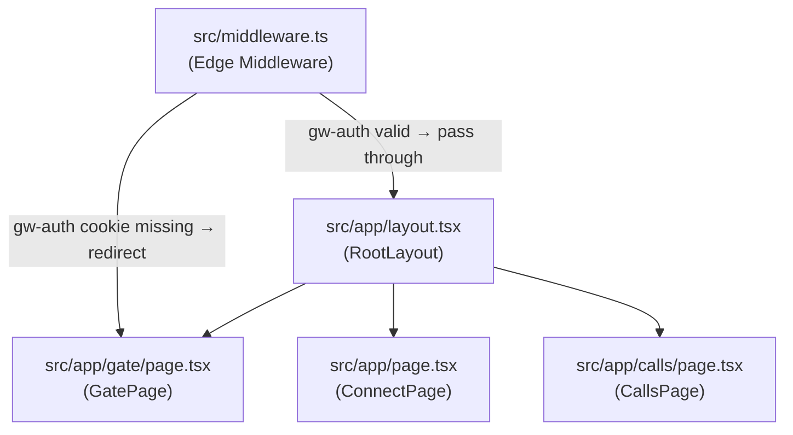

# GongWizard — Component Tree

Generated: 2026-03-04

---

## 1. Page Structure



| Route | File | Layout | Data Fetching |
| --- | --- | --- | --- |
| `/gate` | `src/app/gate/page.tsx` | `RootLayout` | Client-side: `POST /api/auth` on form submit |
| `/` | `src/app/page.tsx` | `RootLayout` | Client-side: `POST /api/gong/connect` on form submit |
| `/calls` | `src/app/calls/page.tsx` | `RootLayout` | Client-side: NDJSON streaming from `POST /api/gong/calls` on mount |

All pages are `'use client'` components. There is no server-side data fetching (no `getServerSideProps`, no RSC data fetching). All API calls originate from browser event handlers or `useEffect`.

**Middleware** (`src/middleware.ts`): Edge runtime. Checks `gw-auth` cookie on every request. Exempts `/gate`, `/api/auth`, and `/favicon`. Redirects unauthenticated requests to `/gate`. Matcher: `/((?!_next/static|_next/image|favicon.ico).*)`.

---

## 2. Component Hierarchy

### `RootLayout` — `src/app/layout.tsx`

```text
RootLayout
└── <html lang="en">
    └── <body> (Geist + Geist_Mono font variables)
        └── {children}
```

Loads Geist and Geist_Mono from `next/font/google`. Sets metadata title and description. No providers, no context.

---

### `GatePage` — `src/app/gate/page.tsx`

```text
GatePage
└── <div> (full-screen centered layout)
    ├── <h1> "GongWizard"
    ├── <p> subtitle
    └── Card
        ├── CardHeader → CardTitle "Team access"
        └── CardContent
            └── <form>
                ├── Label "Access code"
                ├── <div> (relative wrapper)
                │   ├── Input (type password/text)
                │   └── <button> (eye toggle: Eye / EyeOff icon)
                ├── <p> (error display, conditional)
                └── Button (submit: "Enter →" / Loader2 + "Verifying…")
```

---

### `ConnectPage` — `src/app/page.tsx`

```text
ConnectPage
└── <div> (full-screen centered layout)
    ├── <h1> "GongWizard"
    ├── <p> subtitle
    ├── <div> (3 feature bullets)
    ├── Card
    │   ├── CardHeader → CardTitle "Connect your Gong account"
    │   └── CardContent
    │       └── <form>
    │           ├── Label + Input "Access Key"
    │           ├── Label + Input "Secret Key" (with Eye/EyeOff toggle)
    │           ├── Label "Date Range"
    │           │   └── Popover
    │           │       ├── PopoverTrigger → Button (date range display)
    │           │       └── PopoverContent
    │           │           ├── Calendar (mode="range", 2 months)
    │           │           └── <div> "Max range: 1 year" hint
    │           ├── <div> (collapsible help: "Where do I find these?")
    │           │   └── ChevronDown/ChevronUp + ordered list (conditional)
    │           ├── <p> (error display, conditional)
    │           └── Button (submit: "Access My Calls →" / Loader2 + "Connecting…")
    └── <div> (3 trust badges: Lock, X, Shield icons)
```

---

### `CallsPage` — `src/app/calls/page.tsx`

This is the main application page. It manages most application state. The full source is not in the repomix output but its structure is inferable from imports and the components it hosts.

```text
CallsPage
├── (header / nav area)
├── (filter sidebar / panel)
│   ├── Input (text search)
│   ├── Input (participant search)
│   ├── Input (AI content search)
│   ├── MultiSelect (trackers)
│   ├── MultiSelect (topics)
│   ├── Slider (duration range)
│   ├── Slider (talk ratio range)
│   ├── Checkbox (excludeInternal)
│   └── (minExternalSpeakers control)
├── (call list)
│   └── [per-call row with Checkbox + metadata]
├── (export toolbar)
│   ├── Tabs (format selector: markdown / xml / jsonl / csv / utterance-csv)
│   ├── Button "Export"
│   ├── Button "Copy"
│   └── Button "ZIP"
└── AnalyzePanel (right panel / drawer)
    └── src/components/analyze-panel.tsx
```

Hooks consumed by `CallsPage`:

- `useFilterState` — all filter values and setters
- `useCallExport` — export/copy/ZIP handlers

---

### `AnalyzePanel` — `src/components/analyze-panel.tsx`

```text
AnalyzePanel
├── (empty state: selectedCalls.length === 0)
│   └── "How it works" instructional list
└── (active state)
    ├── <div> header (call count + "Start Over" button)
    ├── <div> error display (conditional)
    │
    ├── [Stage: idle / scoring]
    │   ├── Label + Input (question input)
    │   ├── <div> template shortcuts
    │   │   └── [QUESTION_TEMPLATES.map → Button] × 5
    │   └── Button "Find Relevant Calls" / Loader2 + "Scoring calls…"
    │
    ├── [Stage: scored]
    │   ├── Label "Relevance Scores"
    │   ├── ScrollArea (max-h-300px)
    │   │   └── [scoredCalls.map]
    │   │       └── <div> (call row)
    │   │           ├── Checkbox (toggle selected)
    │   │           ├── Badge (score: default/secondary/outline variant)
    │   │           ├── call title + date
    │   │           └── reason text
    │   ├── <p> "{selectedCount} of {total} calls selected"
    │   └── Button "Analyze {n} Calls" / Loader2 + progress message
    │
    ├── [Stage: analyzing]
    │   └── Loader2 + analysisProgress text
    │
    └── [Stage: results]
        ├── Separator
        ├── [conversation.map → QAEntry block] × n
        │   ├── <p> question text
        │   ├── <p> answer text
        │   └── [entry.quotes.map → QuoteCard] × n
        │       └── <div> (border-l quote card)
        │           ├── <p> italic quote
        │           ├── <p> attribution (name, title, company)
        │           └── <p> source (call title · date)
        ├── (follow-up input, if conversation.length < MAX_QUESTIONS)
        │   ├── Input (followUpInput)
        │   └── Button Send / Loader2
        ├── Separator
        ├── <p> tokensUsed display
        └── <div> export buttons
            ├── Button (Download JSON)
            └── Button (Download CSV)
```

Internal subcomponent defined in the same file:

- `QuoteCard({ q: QuoteAttribution })` — renders a single bordered quote with attribution

---

## 3. Component Reference

### `AnalyzePanel`

**File:** `src/components/analyze-panel.tsx`

**Props:**

```typescript
interface AnalyzePanelProps {
  selectedCalls: GongCall[];
  session: GongSession;
  allCalls: GongCall[];
}
```

**State managed:**

| State var | Type | Purpose |
| --- | --- | --- |
| `question` | `string` | Current research question input |
| `stage` | `'idle' \| 'scoring' \| 'scored' \| 'analyzing' \| 'results'` | Pipeline stage |
| `error` | `string` | Error message display |
| `scoredCalls` | `ScoredCall[]` | Calls ranked by relevance after scoring |
| `callFindings` | `CallFindings[]` | Per-call extracted findings after analysis |
| `conversation` | `QAEntry[]` | Q&A history (initial + follow-ups) |
| `analysisProgress` | `string` | Progress message during analysis |
| `followUpInput` | `string` | Follow-up question text input |
| `followUpLoading` | `boolean` | Follow-up request in-flight |
| `processedDataCache` | `string` | Raw processed transcript text for follow-up context |
| `tokensUsed` | `number` | Accumulated token estimate across processed calls |

**Internal types (file-local):**

```typescript
interface ScoredCall {
  callId: string;
  score: number;
  reason: string;
  relevantSections: string[];
  selected: boolean;
}

interface QuoteAttribution {
  quote: string;
  speaker_name: string;
  job_title: string;
  company: string;
  call_title: string;
  call_date: string;
}

interface Finding {
  exact_quote: string;
  speaker_name: string;
  job_title: string;
  company: string;
  is_external: boolean;
  timestamp: string;
  context: string;
  significance: string;
  finding_type: string;
}

interface CallFindings {
  callId: string;
  callTitle: string;
  callDate: string;
  account: string;
  findings: Finding[];
}

interface QAEntry {
  question: string;
  answer: string;
  quotes: QuoteAttribution[];
}

type Stage = 'idle' | 'scoring' | 'scored' | 'analyzing' | 'results';
```

**API calls made:**

- `POST /api/analyze/score` — scores selected calls for question relevance (stage: scoring)
- `POST /api/gong/transcripts` — fetches raw transcript monologues (with `X-Gong-Auth` header)
- `POST /api/analyze/process` — smart truncation of long internal monologues (per-call, conditional)
- `POST /api/analyze/batch-run` — extracts findings from all processed calls in one shot
- `POST /api/analyze/synthesize` — synthesizes findings into a direct answer with quotes
- `POST /api/analyze/followup` — answers follow-up questions against cached evidence

**Hooks used:** `useState`, `useCallback`

**Lib functions used:**

- `isInternalParty`, `escapeCSV` (format-utils)
- `downloadFile` (browser-utils)
- `estimateTokens` (token-utils)
- `buildUtterances`, `alignTrackersToUtterances`, `extractTrackerOccurrences` (tracker-alignment)
- `performSurgery`, `formatExcerptsForAnalysis` (transcript-surgery)

**Constants:**

- `TOKEN_BUDGET = 800_000` — aborts per-call processing loop if exceeded
- `MAX_QUESTIONS = 5` — caps follow-up Q&A depth

**Children rendered:** `QuoteCard` (inline subcomponent in same file)

---

### `MultiSelect`

**File:** `src/components/ui/multi-select.tsx`

**Props:**

```typescript
export interface MultiSelectOption {
  value: string;
  label: string;
  count?: number;
}

interface MultiSelectProps {
  options: MultiSelectOption[];
  selected: Set<string>;
  onToggle: (value: string) => void;
  placeholder?: string;        // default: 'Select...'
  searchPlaceholder?: string;  // default: 'Search...'
  className?: string;
}
```

**State managed:**

- `open: boolean` — controls `Popover` open state

**Children rendered:**

- `Popover` → `PopoverTrigger` → `Button` (shows selected count or labels)
- `PopoverContent` → `Command` → `CommandInput` (only if `options.length > 5`) → `CommandList` → `CommandGroup` → `CommandItem` × n
- Each `CommandItem` renders a custom checkbox div + label + optional count

---

### `Calendar`

**File:** `src/components/ui/calendar.tsx`

**Props:** `React.ComponentProps<typeof DayPicker>` extended with:

```typescript
{
  buttonVariant?: React.ComponentProps<typeof Button>["variant"]
}
```

Defaults: `showOutsideDays=true`, `captionLayout="label"`, `buttonVariant="ghost"`.

**Internal subcomponent:** `CalendarDayButton` — wraps `DayButton` from `react-day-picker`. Uses `useRef<HTMLButtonElement>` and `useEffect` to imperatively focus when `modifiers.focused` is true.

**Used in:** `ConnectPage` (date range picker)

---

### `ConnectPage`

**File:** `src/app/page.tsx`

**State managed:**

| State var | Type | Purpose |
| --- | --- | --- |
| `accessKey` | `string` | Gong API access key input |
| `secretKey` | `string` | Gong API secret key input |
| `showSecret` | `boolean` | Toggle password visibility |
| `showHelp` | `boolean` | Toggle help accordion |
| `loading` | `boolean` | Connection request in-flight |
| `error` | `string` | Error message |
| `dateRange` | `DateRange` | Selected call date range (default: last 3 months) |

**API calls made:**

- `POST /api/gong/connect` (with `X-Gong-Auth: btoa(accessKey:secretKey)`)

**Hooks used:** `useState`, `useRouter`

**Lib functions used:**

- `saveSession` (session.ts) — persists authHeader + connect response to `sessionStorage` under `gongwizard_session`
- `format`, `subMonths`, `subYears`, `differenceInDays` (date-fns)

**Constraint:** `MAX_RANGE_DAYS = 365` — rejects calendar range selections over 1 year

**On success:** calls `router.push('/calls')`

---

### `GatePage`

**File:** `src/app/gate/page.tsx`

**State managed:**

| State var | Type | Purpose |
| --- | --- | --- |
| `password` | `string` | Access code input |
| `showPassword` | `boolean` | Toggle visibility |
| `loading` | `boolean` | Auth request in-flight |
| `error` | `string` | Error message |

**API calls made:**

- `POST /api/auth`

**Hooks used:** `useState`, `useRouter`

**On success:** calls `router.push('/')` then `router.refresh()`

---

## 4. Custom Hooks

### `useFilterState`

**File:** `src/hooks/useFilterState.ts`

**Purpose:** Manages the complete filter state for the calls list. Numeric and boolean filters persist to `localStorage` under key `gongwizard_filters`. Text searches (`searchText`, `participantSearch`, `aiContentSearch`) and multi-selects (`activeTrackers`, `activeTopics`) are session-only — not persisted.

**Parameters:** none

**Return value:**

```typescript
{
  searchText: string;
  setSearchText: (v: string) => void;
  participantSearch: string;
  setParticipantSearch: (v: string) => void;
  aiContentSearch: string;
  setAiContentSearch: (v: string) => void;
  excludeInternal: boolean;
  setExcludeInternal: (v: boolean) => void;
  durationRange: [number, number];          // seconds; default [0, 7200]
  setDurationRange: (v: [number, number]) => void;
  talkRatioRange: [number, number];         // percent; default [0, 100]
  setTalkRatioRange: (v: [number, number]) => void;
  minExternalSpeakers: number;              // default 0
  setMinExternalSpeakers: (v: number) => void;
  activeTrackers: Set<string>;
  toggleTracker: (name: string) => void;
  activeTopics: Set<string>;
  toggleTopic: (name: string) => void;
  resetFilters: () => void;
}
```

**Persisted shape (`PersistedFilters`):**

```typescript
interface PersistedFilters {
  excludeInternal: boolean;
  durationMin: number;
  durationMax: number;
  talkRatioMin: number;
  talkRatioMax: number;
  minExternalSpeakers: number;
}
```

**Side effects:**

- Reads `localStorage` on mount (lazy `useState` initializer via `loadPersistedFilters`)
- Writes `localStorage` on each persisted filter setter call (via `updatePersisted`)
- `resetFilters` calls `localStorage.removeItem(STORAGE_KEY)` directly

**Stability pattern:** `updatePersisted` has `[]` deps. A `currentFilters` ref is kept in sync via `useEffect` so the stable callback can read current values without re-creation.

**React hooks used:** `useState`, `useCallback`, `useRef`, `useEffect`

**Used by:** `CallsPage`

---

### `useCallExport`

**File:** `src/hooks/useCallExport.ts`

**Purpose:** Encapsulates all export logic. Fetches transcripts for selected calls, assembles `CallForExport` objects (with speaker classification, sorted sentences, grouped turns), and dispatches to the appropriate formatter. Supports three output modes: single-file download, clipboard copy, and per-call ZIP with `manifest.json`.

**Parameters:**

```typescript
interface UseCallExportParams {
  selectedIds: Set<string>;
  session: GongSession;
  calls: GongCall[];
  exportFormat: 'markdown' | 'xml' | 'jsonl' | 'csv' | 'utterance-csv';
  exportOpts: ExportOptions;   // { condenseMonologues, includeMetadata, includeAIBrief, includeInteractionStats }
}
```

**Return value:**

```typescript
{
  exporting: boolean;
  copied: boolean;
  handleExport: () => Promise<void>;
  handleCopy: () => Promise<void>;
  handleZipExport: () => Promise<void>;
}
```

**API calls made:**

- `POST /api/gong/transcripts` (with `X-Gong-Auth` header) — batches up to 50 call IDs per request

**Lib functions used:**

- `isInternalParty` (format-utils) — determines internal/external for each party
- `downloadFile`, `downloadBlob` (browser-utils)
- `groupTranscriptTurns`, `buildExportContent` (transcript-formatter)
- `downloadZip` from `client-zip` — used only in `handleZipExport`

**State managed:**

- `exporting: boolean` — any operation in-flight
- `copied: boolean` — clipboard success indicator (resets via `setTimeout` after 2000ms)

**React hooks used:** `useState`, `useCallback`

**Used by:** `CallsPage`

---

## 5. UI Library Notes

**Component library:** shadcn/ui (CLI dev dep `shadcn ^3.8.5`)

**Underlying primitives:** `radix-ui ^1.4.3` — a single consolidated package exporting all Radix UI primitives. Import pattern used throughout: `import { Checkbox as CheckboxPrimitive } from "radix-ui"`.

**Style system:**

- Tailwind CSS v4 (`tailwindcss ^4`, `@tailwindcss/postcss ^4`)
- CSS variable theming (`--primary`, `--muted`, `--destructive`, `--ring`, `--background`, etc.)
- `class-variance-authority ^0.7.1` — variant composition in `Badge`, `Button`, `Tabs`, `TabsList`
- `clsx ^2.1.1` + `tailwind-merge ^3.5.0` — combined in `cn()` utility at `src/lib/utils.ts`
- `tw-animate-css ^1.4.0` — animation utilities (`animate-in`, `fade-in-0`, `zoom-in-95`, etc.)
- Dark mode: supported via `dark:` variants throughout all shadcn components

**Icon library:** `lucide-react ^0.575.0`

Icons used: `Loader2`, `Eye`, `EyeOff`, `Lock`, `X`, `Shield`, `ChevronDown`, `ChevronUp`, `CalendarIcon`, `Search`, `Sparkles`, `Send`, `Download`, `Check`, `CheckIcon`, `ChevronLeftIcon`, `ChevronRightIcon`, `ChevronDownIcon`, `SearchIcon`, `XIcon`

**Command palette:** `cmdk ^1.1.1` — `Command` primitive used inside `MultiSelect` and `CommandDialog`

**Date picker:** `react-day-picker ^9.14.0` — wrapped by `Calendar` with custom `CalendarDayButton`. Used in `ConnectPage` for the call date range selector.

**Date utilities:** `date-fns ^4.1.0` — `format`, `subMonths`, `subYears`, `differenceInDays` in `ConnectPage`; `format` in `useCallExport` for export filenames

**ZIP creation:** `client-zip ^2.5.0` — browser-side, used in `useCallExport.handleZipExport`

**shadcn components in use (15 files, covering all exports):**

| Component file | Exported names | Primitive |
| --- | --- | --- |
| `src/components/ui/badge.tsx` | `Badge`, `badgeVariants` | `Slot` (radix-ui) |
| `src/components/ui/button.tsx` | `Button`, `buttonVariants` | `Slot` (radix-ui) |
| `src/components/ui/calendar.tsx` | `Calendar`, `CalendarDayButton` | `DayPicker` (react-day-picker) |
| `src/components/ui/card.tsx` | `Card`, `CardHeader`, `CardTitle`, `CardDescription`, `CardAction`, `CardContent`, `CardFooter` | native `<div>` |
| `src/components/ui/checkbox.tsx` | `Checkbox` | `Checkbox` (radix-ui) |
| `src/components/ui/command.tsx` | `Command`, `CommandDialog`, `CommandInput`, `CommandList`, `CommandEmpty`, `CommandGroup`, `CommandItem`, `CommandSeparator`, `CommandShortcut` | `Command` (cmdk) + `Dialog` (radix-ui) |
| `src/components/ui/dialog.tsx` | `Dialog`, `DialogTrigger`, `DialogContent`, `DialogHeader`, `DialogFooter`, `DialogTitle`, `DialogDescription`, `DialogClose`, `DialogOverlay`, `DialogPortal` | `Dialog` (radix-ui) |
| `src/components/ui/input.tsx` | `Input` | native `<input>` |
| `src/components/ui/label.tsx` | `Label` | `Label` (radix-ui) |
| `src/components/ui/multi-select.tsx` | `MultiSelect`, `MultiSelectOption` | `Popover` + `Command` (custom composition) |
| `src/components/ui/popover.tsx` | `Popover`, `PopoverTrigger`, `PopoverContent`, `PopoverAnchor`, `PopoverHeader`, `PopoverTitle`, `PopoverDescription` | `Popover` (radix-ui) |
| `src/components/ui/scroll-area.tsx` | `ScrollArea`, `ScrollBar` | `ScrollArea` (radix-ui) |
| `src/components/ui/separator.tsx` | `Separator` | `Separator` (radix-ui) |
| `src/components/ui/slider.tsx` | `Slider` | `Slider` (radix-ui) |
| `src/components/ui/tabs.tsx` | `Tabs`, `TabsList`, `TabsTrigger`, `TabsContent`, `tabsListVariants` | `Tabs` (radix-ui) |
