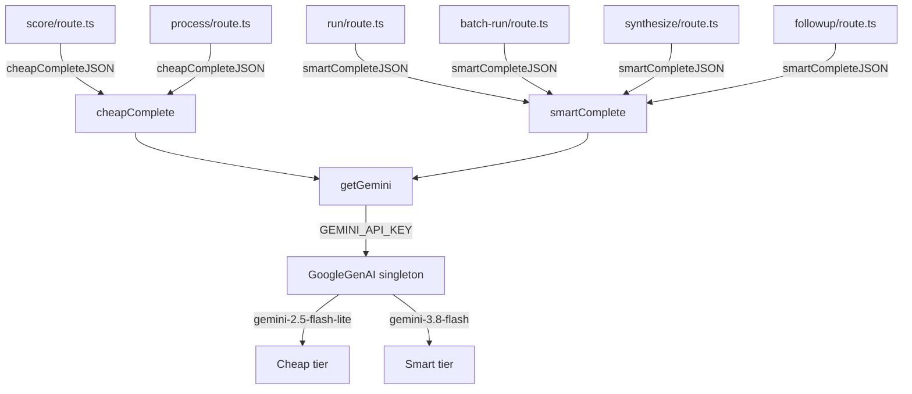

# Configuration Reference

## 1. Environment Variables

GongWizard has exactly two server-side environment variables. No `.env.example` exists — the only `process.env` references in the entire codebase are `SITE_PASSWORD` and `GEMINI_API_KEY`.

| Name | Purpose | Required/Optional | Default Value | Where Used |
| --- | --- | --- | --- | --- |
| `SITE_PASSWORD` | Password verified by `POST /api/auth` to issue the `gw-auth` session cookie. If unset, the route returns HTTP 500 with `'Server misconfigured'`. | Required | None | `src/app/api/auth/route.ts` |
| `GEMINI_API_KEY` | API key for Google Gemini AI. Consumed by the lazy singleton `getGemini()` to construct a `GoogleGenAI` client. Missing key throws `'GEMINI_API_KEY not configured'` at call time. | Required for AI analysis features | None | `src/lib/ai-providers.ts` |

**Important notes:**

- No database is used. Gong API credentials are user-supplied at runtime on the Connect page (`src/app/page.tsx`). The client Base64-encodes them (`btoa(accessKey:secretKey)`) into an `authHeader` string, stores it in browser `sessionStorage` under `gongwizard_session`, and forwards it to proxy routes via the `X-Gong-Auth` request header. They are never stored server-side and are not environment variables.
- The `openai` package appears in `package.json` (`^6.25.0`) but has no `process.env.OPENAI_API_KEY` reference in any current source file — it is installed but unused.

**Local development setup** — create `.env.local` in the project root:

```sh
SITE_PASSWORD=your_site_password
GEMINI_API_KEY=your_gemini_api_key
```

---

## 2. Build / Runtime Configuration

### `next.config.ts`

Location: `next.config.ts` (project root)

```typescript
const nextConfig: NextConfig = {
  /* config options here */
};
```

The config object is empty — no custom Next.js settings are applied. All behavior follows Next.js 16.1.6 defaults, including the App Router and Turbopack dev server (Turbopack is enabled by default in Next.js 16 via `next dev`).

One route-level override exists outside `next.config.ts`: `export const maxDuration = 60` is declared at the top of four API route files. This is a Vercel-specific export that raises the serverless function timeout from the platform default to 60 seconds.

| File | `maxDuration` |
| --- | --- |
| `src/app/api/analyze/batch-run/route.ts` | `60` s |
| `src/app/api/analyze/run/route.ts` | `60` s |
| `src/app/api/analyze/synthesize/route.ts` | `60` s |
| `src/app/api/analyze/followup/route.ts` | `60` s |

---

### `tsconfig.json`

Location: `tsconfig.json` (project root)

| Option | Value | Effect |
| --- | --- | --- |
| `target` | `"ES2017"` | Compiles output to ES2017 |
| `lib` | `["dom", "dom.iterable", "esnext"]` | Includes browser DOM types and latest ES globals |
| `strict` | `true` | All strict type-checks enabled |
| `noEmit` | `true` | Type-check only; Next.js handles actual compilation |
| `module` | `"esnext"` | ESM module format |
| `moduleResolution` | `"bundler"` | Matches Next.js/Turbopack resolution strategy |
| `resolveJsonModule` | `true` | Allows importing `.json` files as typed modules |
| `isolatedModules` | `true` | Each file compiled independently (required for SWC/Turbopack) |
| `jsx` | `"react-jsx"` | React 17+ automatic JSX transform — no need to import React |
| `incremental` | `true` | Enables incremental compilation cache |
| `plugins` | `[{ "name": "next" }]` | Activates the Next.js TypeScript plugin for IDE diagnostics |
| `paths` | `{ "@/*": ["./src/*"] }` | `@/` alias resolves to `src/` throughout the codebase |

---

### Tailwind CSS

Tailwind v4 is used with CSS-native configuration — there is no `tailwind.config.ts` or `tailwind.config.js`. All theme tokens and overrides live in `src/app/globals.css`.

**CSS imports at the top of `src/app/globals.css`:**

```css
@import "tailwindcss";
@import "tw-animate-css";
@import "shadcn/tailwind.css";
```

**Dark mode variant:**

```css
@custom-variant dark (&:is(.dark *));
```

Activated by adding the `.dark` class to a parent element.

**Font tokens mapped in `@theme inline`:**

| CSS Variable | Maps To | Source |
| --- | --- | --- |
| `--font-sans` | `var(--font-geist-sans)` | Geist Sans, loaded via `next/font/google` in `src/app/layout.tsx` |
| `--font-mono` | `var(--font-geist-mono)` | Geist Mono, loaded via `next/font/google` in `src/app/layout.tsx` |

**Border radius tokens** (base `--radius: 0.625rem`):

| Token | Value |
| --- | --- |
| `--radius-sm` | `calc(var(--radius) - 4px)` |
| `--radius-md` | `calc(var(--radius) - 2px)` |
| `--radius-lg` | `var(--radius)` |
| `--radius-xl` | `calc(var(--radius) + 4px)` |
| `--radius-2xl` | `calc(var(--radius) + 8px)` |
| `--radius-3xl` | `calc(var(--radius) + 12px)` |
| `--radius-4xl` | `calc(var(--radius) + 16px)` |

**Semantic color tokens** — defined in `:root` (light) and `.dark` blocks using `oklch()` color space. All are consumed by shadcn/ui components via the `@theme inline` mapping:

`--background`, `--foreground`, `--card`, `--card-foreground`, `--popover`, `--popover-foreground`, `--primary`, `--primary-foreground`, `--secondary`, `--secondary-foreground`, `--muted`, `--muted-foreground`, `--accent`, `--accent-foreground`, `--destructive`, `--border`, `--input`, `--ring`, `--chart-1` through `--chart-5`, and sidebar variants (`--sidebar`, `--sidebar-foreground`, `--sidebar-primary`, `--sidebar-primary-foreground`, `--sidebar-accent`, `--sidebar-accent-foreground`, `--sidebar-border`, `--sidebar-ring`).

---

### ESLint

| Property | Value |
| --- | --- |
| ESLint version | `^9` (flat config format) |
| Extends | `eslint-config-next` `16.1.6` |
| Run command | `npm run lint` |

---

## 3. Feature Flags / Constants

These are hardcoded values controlling behavior. None are runtime-configurable without a code change.

### `src/lib/gong-api.ts`

| Name | Value | Type | What It Controls |
| --- | --- | --- | --- |
| `GONG_RATE_LIMIT_MS` | `350` | `number` (ms) | Sleep delay between consecutive Gong API requests. Keeps rate safely under Gong's ~3 req/s limit. Used in every proxy route that paginates or batches. |
| `EXTENSIVE_BATCH_SIZE` | `10` | `number` | Max call IDs per `POST /v2/calls/extensive` request. Gong API hard limit. Used in `src/app/api/gong/calls/route.ts`. |
| `TRANSCRIPT_BATCH_SIZE` | `50` | `number` | Max call IDs per `POST /v2/calls/transcript` request. Gong API hard limit. Used in `src/app/api/gong/transcripts/route.ts` and `src/app/api/gong/search/route.ts`. |
| `MAX_RETRIES` | `5` | `number` | Maximum retry attempts for failed Gong API requests before throwing. 401/403/404 errors throw immediately without retrying. |
| Retry backoff formula | `Math.min(2 ** attempt * 2, 30) * 1000` ms | — | Exponential backoff: 2 s → 4 s → 8 s → 16 s → 30 s (capped). `Retry-After` header from Gong overrides this when present on 429 responses. |

---

### `src/app/api/gong/calls/route.ts`

| Name | Value | Type | What It Controls |
| --- | --- | --- | --- |
| `DEFAULT_DAYS` | `90` | `number` | Date range (days back from now) used when no `fromDate`/`toDate` is sent in the request body. |
| `CHUNK_DAYS` | `30` | `number` | The requested date range is split into 30-day windows by `buildDateChunks()` for optimal Gong API performance. Each chunk is fetched sequentially with `GONG_RATE_LIMIT_MS` between requests. |

---

### `src/app/page.tsx` (Connect Page)

| Name | Value | Type | What It Controls |
| --- | --- | --- | --- |
| `MAX_RANGE_DAYS` | `365` | `number` | Maximum date range in days that the user can select on the Connect page date picker. Enforced client-side via `differenceInDays` from `date-fns`. |

Default date range on the Connect page: `from: subMonths(today, 3)`, `to: today`.

---

### `src/lib/session.ts`

| Name | Value | Type | What It Controls |
| --- | --- | --- | --- |
| `SESSION_KEY` | `'gongwizard_session'` | `string` | `sessionStorage` key for the `GongSession` object (managed by `saveSession` and `getSession`). Stores `authHeader`, `users`, `trackers`, `workspaces`, `internalDomains`, `baseUrl`, `fromDate`, `toDate`. Cleared automatically when the tab closes. |

---

### `src/hooks/useFilterState.ts`

| Name | Value | Type | What It Controls |
| --- | --- | --- | --- |
| `STORAGE_KEY` | `'gongwizard_filters'` | `string` | `localStorage` key for persisting the `PersistedFilters` shape across page reloads: `excludeInternal`, `durationMin`, `durationMax`, `talkRatioMin`, `talkRatioMax`, `minExternalSpeakers`. |

Default filter values (on first load or after `resetFilters()`):

| Filter | Default |
| --- | --- |
| `durationMin` | `0` s |
| `durationMax` | `7200` s (2 hours) |
| `talkRatioMin` | `0` % |
| `talkRatioMax` | `100` % |
| `minExternalSpeakers` | `0` |
| `excludeInternal` | `false` |

---

### `src/lib/transcript-surgery.ts`

| Name | Value | Type | What It Controls |
| --- | --- | --- | --- |
| `GREETING_CLOSING_WINDOW_MS` | `60_000` | `number` (ms) | First and last 60 seconds of a call are treated as greeting/closing zones. Utterances with fewer than 15 words in these zones are excluded by `isGreetingOrClosing()`. |
| `FILLER_PATTERNS` | Regex array | `RegExp[]` | Matches single-word or short filler responses (`hi`, `yes`, `okay`, `mm-hmm`, etc.). Used by `isFiller()`. Utterances shorter than 5 characters are also treated as fillers unconditionally. |
| Smart truncation threshold | `60` words | `number` | Internal-speaker monologues over 60 words are flagged `needsSmartTruncation = true` in the `SurgicalExcerpt` and routed to `POST /api/analyze/process` for AI-assisted condensing. |

---

### `src/lib/token-utils.ts`

Token estimation formula in `estimateTokens`: `Math.ceil(text.length / 4)` — characters-to-tokens heuristic, no tokenizer library.

---

### `src/components/analyze-panel.tsx`

| Name | Value | Type | What It Controls |
| --- | --- | --- | --- |
| `TOKEN_BUDGET` | `800_000` | `number` | Maximum estimated tokens of transcript context submitted to Gemini 2.5 Pro per analysis run. Leaves headroom for system prompt and output within the ~1M token context window. The `AnalyzePanel` component trims calls from the batch if the budget would be exceeded. |
| `MAX_QUESTIONS` | `5` | `number` | Maximum follow-up questions a user may ask per analysis session. Enforced in `AnalyzePanel`; UI shows remaining count and disables input once the limit is reached. |

Question template shortcuts hardcoded in `QUESTION_TEMPLATES`:

| Label | Default question text |
| --- | --- |
| `'Objections'` | `'What objections are customers raising?'` |
| `'Needs'` | `'What unmet needs are customers expressing?'` |
| `'Competitive'` | `'What are customers saying about competitors?'` |
| `'Feedback'` | `'What product feedback are customers giving?'` |
| `'Questions'` | `'What questions are customers asking most?'` |

---

### `src/app/api/auth/route.ts` — Auth Cookie

| Property | Value |
| --- | --- |
| Cookie name | `gw-auth` |
| Cookie value on success | `'1'` |
| `httpOnly` | `true` |
| `maxAge` | `604800` s (7 days) |
| `path` | `'/'` |
| `sameSite` | `'lax'` |

---

### `src/middleware.ts` — Middleware Matcher

| Property | Value |
| --- | --- |
| Matcher pattern | `['/((?!_next/static\|_next/image\|favicon.ico).*)']` |
| Bypassed paths | Routes starting with `/gate`, `/api/auth`, `/favicon` |
| Auth check | Cookie `gw-auth` value must equal `'1'`; otherwise redirects to `/gate` |

---

### AI model IDs and invocation parameters

Defined in `src/lib/ai-providers.ts`:

| Tier | Model ID | Default `temperature` | Default `maxOutputTokens` |
| --- | --- | --- | --- |
| Cheap (`cheapComplete` / `cheapCompleteJSON`) | `'gemini-2.5-flash-lite'` | `0.3` | `1024` |
| Smart (`smartComplete` / `smartCompleteJSON` / `smartStream`) | `'gemini-3.8-flash'` | `0.3` | `8192` |

All JSON-returning calls pass `responseMimeType: 'application/json'` to the Gemini API (native structured output mode), enabled by `jsonMode: true` internally.

Per-route overrides:

| Route | Function | `temperature` | `maxTokens` | Purpose |
| --- | --- | --- | --- | --- |
| `src/app/api/analyze/score/route.ts` | `cheapCompleteJSON` | `0.2` | `4096` | Batch relevance scoring (0–10) |
| `src/app/api/analyze/process/route.ts` | `cheapCompleteJSON` | `0.2` | `2048` | Smart truncation of long internal monologues |
| `src/app/api/analyze/run/route.ts` | `smartCompleteJSON` | `0.3` | `4096` | Single-call finding extraction |
| `src/app/api/analyze/batch-run/route.ts` | `smartCompleteJSON` | `0.3` | `16384` | Multi-call batch finding extraction |
| `src/app/api/analyze/synthesize/route.ts` | `smartCompleteJSON` | `0.3` | `4096` | Cross-call synthesis |
| `src/app/api/analyze/followup/route.ts` | `smartCompleteJSON` | `0.3` | `4096` | Follow-up Q&A against cached evidence |

---

### Gong API default base URL

All proxy routes accept an optional `baseUrl` field in the POST body (trailing slashes are stripped). When omitted, the default is `https://api.gong.io`. Supports custom Gong instance URLs used by some enterprise deployments. Applies in `src/app/api/gong/connect/route.ts`, `calls/route.ts`, `transcripts/route.ts`, and `search/route.ts`.

---

### Keyword search cap

| Location | Value | What It Controls |
| --- | --- | --- |
| `src/app/api/gong/search/route.ts` | `500` | Maximum call IDs accepted per search request (`callIds.slice(0, 500)`). |

---

## 4. Third-Party Service Configuration

### Google Gemini

**Purpose:** Powers all AI features — call relevance scoring, smart truncation of internal monologues, per-call finding extraction, multi-call batch extraction, cross-call synthesis, and follow-up Q&A.

| Property | Detail |
| --- | --- |
| Required env var | `GEMINI_API_KEY` |
| SDK package | `@google/genai` `^1.43.0` |
| Client initialization | `src/lib/ai-providers.ts` — module-level lazy singleton: `let _gemini: GoogleGenAI \| null = null`, initialized on first `getGemini()` call as `new GoogleGenAI({ apiKey: process.env.GEMINI_API_KEY })` |
| Cheap tier model | `'gemini-2.5-flash-lite'` — invoked by `cheapCompleteJSON` |
| Smart tier model | `'gemini-3.8-flash'` — invoked by `smartCompleteJSON` and `smartStream` |
| Server-side only | Yes — `GEMINI_API_KEY` is only available server-side; never sent to the browser |



---

### Gong API

**Purpose:** Source of all call data — users, trackers, workspaces, call list, full call metadata, and transcript monologues. GongWizard operates as a stateless proxy; Gong credentials are never stored server-side.

| Property | Detail |
| --- | --- |
| Required env var | None — credentials are user-supplied at runtime |
| Auth mechanism | HTTP Basic Auth (`Authorization: Basic <base64(accessKey:secretKey)>`), forwarded proxy-style via the `X-Gong-Auth` request header from client to proxy routes |
| Client initialization | `src/lib/gong-api.ts` — `makeGongFetch(baseUrl, authHeader)` factory function. Returns a fetch wrapper with retry/backoff logic. Called at the start of each proxy route handler; no persistent client instance. |
| Credential storage | Browser `sessionStorage` only, under `SESSION_KEY = 'gongwizard_session'` (managed by `src/lib/session.ts`). Cleared on tab close. |
| Default base URL | `https://api.gong.io` |

Proxy routes and the Gong endpoints they call:

| Proxy Route | Gong Endpoints Called |
| --- | --- |
| `src/app/api/gong/connect/route.ts` | `GET /v2/users`, `GET /v2/settings/trackers`, `GET /v2/workspaces` |
| `src/app/api/gong/calls/route.ts` | `GET /v2/calls`, `POST /v2/calls/extensive` |
| `src/app/api/gong/transcripts/route.ts` | `POST /v2/calls/transcript` |
| `src/app/api/gong/search/route.ts` | `POST /v2/calls/transcript` |

---

### Vercel

**Purpose:** Serverless deployment host for the Next.js application and all API route handlers.

| Property | Detail |
| --- | --- |
| Env vars to configure in Vercel | `SITE_PASSWORD`, `GEMINI_API_KEY` |
| Default function timeout | 10 s platform default; overridden to `60` s for the four AI analysis routes |
| Deploy trigger | Push to `main` branch triggers automatic deployment |
| Project name | `gongwizard` |

---

### `next/font/google` (Geist fonts)

**Purpose:** Self-hosting Geist Sans and Geist Mono at build time via Next.js font optimization, eliminating external font requests.

| Property | Detail |
| --- | --- |
| Initialization | `src/app/layout.tsx` — `Geist({ variable: '--font-geist-sans', subsets: ['latin'] })` and `Geist_Mono({ variable: '--font-geist-mono', subsets: ['latin'] })` |
| CSS variables injected | `--font-geist-sans`, `--font-geist-mono` — consumed by `@theme inline` in `src/app/globals.css` |
| API key required | No |

---

### `client-zip`

**Purpose:** Browser-side ZIP archive creation for bulk transcript exports.

| Property | Detail |
| --- | --- |
| Package | `client-zip` `^2.5.0` |
| Usage location | `src/hooks/useCallExport.ts` — `handleZipExport` callback imports `downloadZip` and bundles multiple transcript files into a single `.zip` |
| API key required | No — runs entirely in the browser |
