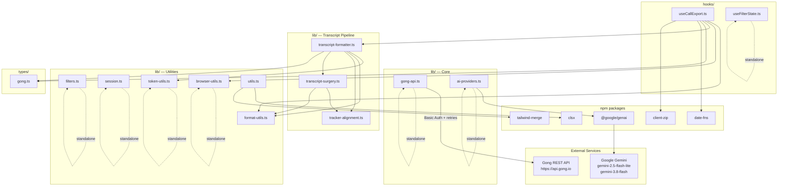

# GongWizard — Lib Module Documentation

Generated from `src/lib/`, `src/hooks/`, and `src/types/`.

---

## Table of Contents

1. [Module Overview](#module-overview)
   - [src/lib/gong-api.ts](#srclibgong-apits)
   - [src/lib/ai-providers.ts](#srclibai-providersts)
   - [src/lib/transcript-formatter.ts](#srclibtranscript-formatterts)
   - [src/lib/transcript-surgery.ts](#srclibtranscript-surgeryts)
   - [src/lib/tracker-alignment.ts](#srclibtracker-alignmentts)
   - [src/lib/filters.ts](#srclibfiltersts)
   - [src/lib/session.ts](#srclibsessionts)
   - [src/lib/format-utils.ts](#srclibformat-utilsts)
   - [src/lib/token-utils.ts](#srclibtoken-utilsts)
   - [src/lib/browser-utils.ts](#srclibbrowser-utilsts)
   - [src/lib/utils.ts](#srclibutils)
   - [src/hooks/useCallExport.ts](#srchooksusecallexportts)
   - [src/hooks/useFilterState.ts](#srchooksusefilterstatets)
   - [src/types/gong.ts](#srctypesgongts)
2. [Dependency Graph](#dependency-graph)
3. [Constants and Configuration](#constants-and-configuration)

---

## Module Overview

### src/lib/gong-api.ts

Shared Gong API utilities used by all server-side proxy routes. Provides authenticated fetch with exponential backoff, rate limit constants, batch size limits, and a standardized error type.

**Key exports:**

```ts
class GongApiError extends Error {
  constructor(status: number, message: string, endpoint: string)
}

function sleep(ms: number): Promise<void>

function makeGongFetch(
  baseUrl: string,
  authHeader: string
): (endpoint: string, options?: RequestInit) => Promise<any>

function handleGongError(error: unknown): NextResponse

export const GONG_RATE_LIMIT_MS: number    // 350
export const EXTENSIVE_BATCH_SIZE: number  // 10
export const TRANSCRIPT_BATCH_SIZE: number // 50
```

**External dependencies:** `next/server` (NextResponse)

**Internal dependencies:** none

---

### src/lib/ai-providers.ts

Gemini AI abstraction layer. Exposes a cheap tier (`gemini-2.5-flash-lite`) for scoring and truncation, and a smart tier (`gemini-3.8-flash`) for finding extraction, synthesis, and follow-up Q&A. Both tiers have JSON and streaming variants. Lazily initializes a single shared `GoogleGenAI` client from `GEMINI_API_KEY`.

**Key exports:**

```ts
async function cheapCompleteJSON<T = unknown>(
  prompt: string,
  options?: { temperature?: number; maxTokens?: number }
): Promise<T>

async function smartCompleteJSON<T = unknown>(
  prompt: string,
  options?: { temperature?: number; maxTokens?: number; systemPrompt?: string }
): Promise<T>

async function* smartStream(
  prompt: string,
  options?: { temperature?: number; maxTokens?: number; systemPrompt?: string }
): AsyncGenerator<string>
```

**External dependencies:** `@google/genai` (GoogleGenAI)

**Internal dependencies:** none

---

### src/lib/transcript-formatter.ts

All export rendering logic. Converts `CallForExport` objects into Markdown, XML, JSONL, summary CSV, and utterance-level CSV. Also owns `groupTranscriptTurns` which converts flat sentence arrays into speaker-turn groups, and `truncateLongInternalTurns` which clips internal rep turns of 150+ words to first 2 + last 2 sentences. `buildExportContent` is the single dispatch function called by `useCallExport`.

**Key exports:**

```ts
// Types
interface Speaker {
  speakerId: string; name: string; firstName: string;
  isInternal: boolean; title?: string;
}
interface TranscriptSentence { speakerId: string; text: string; start: number }
interface FormattedTurn {
  speakerId: string; firstName: string; isInternal: boolean;
  timestamp: string; text: string;
}
interface CallForExport {
  id: string; title: string; date: string; duration: number; accountName: string;
  speakers: Speaker[]; brief: string; turns: FormattedTurn[];
  interactionStats?: InteractionStats;
  rawMonologues?: Array<{
    speakerId: string;
    sentences?: Array<{ text: string; start: number; end?: number }>;
  }>;
}
interface ExportOptions {
  condenseMonologues: boolean; includeMetadata: boolean;
  includeAIBrief: boolean; includeInteractionStats: boolean;
}

// Functions
function groupTranscriptTurns(
  sentences: TranscriptSentence[],
  speakerMap: Map<string, Speaker>
): FormattedTurn[]

function truncateLongInternalTurns(turns: FormattedTurn[]): FormattedTurn[]

function buildMarkdown(calls: CallForExport[], opts: ExportOptions): string
function buildXML(calls: CallForExport[], opts: ExportOptions): string
function buildJSONL(calls: CallForExport[], opts: ExportOptions): string
function buildCSVSummary(calls: CallForExport[], allCalls: GongCall[]): string
function buildUtteranceCSV(calls: CallForExport[], allCalls: GongCall[]): string

function buildExportContent(
  calls: CallForExport[],
  fmt: 'markdown' | 'xml' | 'jsonl' | 'csv' | 'utterance-csv',
  opts: ExportOptions,
  allCalls?: GongCall[]
): { content: string; extension: string; mimeType: string }
```

**External dependencies:** none (pure string manipulation)

**Internal dependencies:**

- `src/lib/token-utils.ts` — `estimateTokens` (token count header in Markdown)
- `src/lib/format-utils.ts` — `formatDuration`, `formatTimestamp`, `escapeCSV`
- `src/lib/tracker-alignment.ts` — `buildUtterances`, `alignTrackersToUtterances`, `extractTrackerOccurrences` (utterance CSV)
- `src/lib/transcript-surgery.ts` — `findNearestOutlineItem`, `OutlineSection` (utterance CSV outline section lookup)
- `src/types/gong.ts` — `InteractionStats`, `GongCall`

---

### src/lib/transcript-surgery.ts

Surgical transcript extraction for the AI analysis pipeline. Reduces a full call transcript (~16K tokens) to a dense 2–3K excerpt block by filtering out filler, short utterances, greeting/closing windows, and off-topic sections. Handles context enrichment (reach-back to preceding utterance), long internal monologue flagging for AI-assisted condensing, and Gong AI outline item annotation. Ported and extended from GongWizard V2.

**Key exports:**

```ts
// Types
interface OutlineSection {
  name: string; startTimeMs: number; durationMs: number;
  items?: Array<{ text: string; startTimeMs: number; durationMs: number }>;
}
interface SurgicalExcerpt {
  speakerId: string; text: string; timestampMs: number; timestampFormatted: string;
  isInternal: boolean; trackers: string[]; sectionName?: string;
  needsSmartTruncation: boolean; // true if internal monologue > 60 words
  contextBefore?: string; outlineItemText?: string;
  speakerName?: string; speakerTitle?: string;
}
interface SurgeryResult {
  callId: string; excerpts: SurgicalExcerpt[]; sectionsUsed: string[];
  originalUtteranceCount: number; extractedUtteranceCount: number;
  longInternalMonologues: Array<{ index: number; text: string; wordCount: number }>;
}

// Functions
function buildChapterWindows(
  outline: OutlineSection[],
  relevantSections: string[]
): Array<{ name: string; startMs: number; endMs: number }>

function findNearestOutlineItem(
  outline: OutlineSection[],
  timestampMs: number,
  windowMs?: number  // default 30_000 ms
): string | undefined

function performSurgery(
  callId: string,
  utterances: Utterance[],
  outline: OutlineSection[],
  relevantSections: string[],
  callDurationMs: number,
  speakerMap?: Record<string, { name: string; title: string }>
): SurgeryResult

function buildSmartTruncationPrompt(
  question: string,
  monologues: Array<{ index: number; text: string }>
): string

function formatExcerptsForAnalysis(
  excerpts: SurgicalExcerpt[],
  callTitle: string,
  callDate: string,
  accountName: string,
  talkRatioPct: number,
  trackersFired: string[],
  relevantSections: string[],
  keyPoints: string[],
  externalOnly?: boolean  // default false
): string
```

**External dependencies:** none

**Internal dependencies:**

- `src/lib/tracker-alignment.ts` — `Utterance` type
- `src/lib/format-utils.ts` — `formatTimestamp`

---

### src/lib/tracker-alignment.ts

Four-step tracker-to-utterance alignment algorithm ported from GongWizard V2 (`app.py` lines 650–730). Converts raw Gong transcript monologues into `Utterance` objects with millisecond timestamps, then assigns tracker occurrences to the nearest utterance using: (1) exact containment, (2) ±3s fallback, (3) speaker preference, (4) closest midpoint. Mutates utterances in place by appending tracker names to their `.trackers` array.

**Key exports:**

```ts
interface TrackerOccurrence {
  trackerName: string; phrase?: string; startTimeMs: number; speakerId?: string;
}
interface Utterance {
  speakerId: string; text: string; startTimeMs: number; endTimeMs: number;
  midTimeMs: number; trackers: string[]; isInternal: boolean;
}

function buildUtterances(
  monologues: Array<{
    speakerId: string;
    sentences?: Array<{ text: string; start: number; end?: number }>;
  }>,
  speakerClassifier: (speakerId: string) => boolean
): Utterance[]

function alignTrackersToUtterances(
  utterances: Utterance[],
  trackerOccurrences: TrackerOccurrence[]
): string[]  // returns unmatched tracker names

function extractTrackerOccurrences(
  trackers: Array<{
    name: string;
    occurrences?: Array<{ startTimeMs: number; speakerId?: string; phrase?: string }>;
  }>
): TrackerOccurrence[]
```

**External dependencies:** none

**Internal dependencies:** none

---

### src/lib/filters.ts

Pure filter predicates for the call list. Each function takes a `FilterableCall` and one or more filter parameters and returns a boolean. Two aggregation helpers compute tracker/topic counts across the full call set for populating filter dropdowns with counts.

**Key exports:**

```ts
interface FilterableCall {
  title: string; brief?: string; duration: number; topics?: string[];
  trackers?: string[]; parties?: any[]; externalSpeakerCount: number;
  talkRatio?: number; keyPoints?: string[]; actionItems?: string[];
  outline?: Array<{ name: string; items?: Array<{ text: string }> }>;
}

function matchesTextSearch(call: FilterableCall, query: string): boolean
function matchesTrackers(call: FilterableCall, activeTrackers: Set<string>): boolean
function matchesTopics(call: FilterableCall, activeTopics: Set<string>): boolean
function matchesDurationRange(call: FilterableCall, min: number, max: number): boolean
function matchesTalkRatioRange(call: FilterableCall, min: number, max: number): boolean
function matchesParticipantName(call: FilterableCall, query: string): boolean
function matchesMinExternalSpeakers(call: FilterableCall, min: number): boolean
function matchesAiContentSearch(call: FilterableCall, query: string): boolean

function computeTrackerCounts(
  calls: FilterableCall[], allTrackers: string[]
): Record<string, number>

function computeTopicCounts(calls: FilterableCall[]): Record<string, number>
```

**Notes:**

- `matchesAiContentSearch` searches `brief`, `keyPoints`, `actionItems`, and outline items — Gong AI-generated content, not the raw transcript text.
- `matchesTalkRatioRange` converts `talkRatio` (0–1 float) to an integer percentage before comparing against the min/max slider values.

**External dependencies:** none

**Internal dependencies:** none

---

### src/lib/session.ts

Thin `sessionStorage` wrapper for the Gong session. Stores and retrieves the `gongwizard_session` key, which holds `authHeader`, `users`, `trackers`, `workspaces`, `internalDomains`, and `baseUrl`. Returns `null` on parse failure or when `sessionStorage` is unavailable.

**Key exports:**

```ts
function saveSession(data: Record<string, unknown>): void
function getSession(): Record<string, unknown> | null
```

**External dependencies:** none (browser `sessionStorage`)

**Internal dependencies:** none

---

### src/lib/format-utils.ts

Shared display and serialization utilities used across both client and server code.

**Key exports:**

```ts
function formatDuration(seconds: number): string
// e.g. 3725 → "1h 2m", 185 → "3m 5s"

function formatTimestamp(ms: number): string
// e.g. 185000 → "3:05"

function isInternalParty(party: any, internalDomains: string[]): boolean
// Checks party.affiliation === 'Internal' first; falls back to email domain match

function escapeCSV(val: string): string
// Wraps in quotes and escapes internal quotes if value contains comma, quote, or newline

function truncateToFirstSentence(text: string, maxChars?: number): string
// maxChars defaults to 120; truncates at sentence boundary or hard limit with ellipsis
```

**External dependencies:** none

**Internal dependencies:** none

---

### src/lib/token-utils.ts

Token count estimation for the export UI's context window guidance display. Uses the standard length/4 approximation.

**Key exports:**

```ts
function estimateTokens(text: string): number
// Returns Math.ceil(text.length / 4)
```

**External dependencies:** none

**Internal dependencies:** none

---

### src/lib/browser-utils.ts

Browser-only file download utilities. Creates an ephemeral `<a>` element with an object URL, triggers a programmatic click, then immediately revokes the URL to free memory.

**Key exports:**

```ts
function downloadFile(content: string, filename: string, mimeType: string): void
function downloadBlob(blob: Blob, filename: string): void
```

**External dependencies:** none (browser `URL.createObjectURL`, `document.createElement`)

**Internal dependencies:** none

---

### src/lib/utils.ts

shadcn/ui standard `cn()` class name helper. Merges conditional class names and resolves Tailwind class conflicts via `tailwind-merge`.

**Key exports:**

```ts
function cn(...inputs: ClassValue[]): string
```

**External dependencies:** `clsx`, `tailwind-merge`

**Internal dependencies:** none

---

### src/hooks/useCallExport.ts

Client hook that orchestrates the full export workflow: fetches transcripts via `/api/gong/transcripts`, assembles `CallForExport` objects (building speaker maps from parties, grouping transcript sentences into turns), then dispatches to `buildExportContent`. Supports single-file download, clipboard copy, and ZIP export (one file per call + `manifest.json`).

**Key exports:**

```ts
interface UseCallExportParams {
  selectedIds: Set<string>;
  session: GongSession;
  calls: GongCall[];
  exportFormat: 'markdown' | 'xml' | 'jsonl' | 'csv' | 'utterance-csv';
  exportOpts: ExportOptions;
}

function useCallExport(params: UseCallExportParams): {
  exporting: boolean;
  copied: boolean;
  handleExport: () => Promise<void>;
  handleCopy: () => Promise<void>;
  handleZipExport: () => Promise<void>;
}
```

**External dependencies:** `date-fns` (format), `client-zip` (downloadZip)

**Internal dependencies:**

- `src/lib/format-utils.ts` — `isInternalParty`
- `src/lib/browser-utils.ts` — `downloadFile`, `downloadBlob`
- `src/lib/transcript-formatter.ts` — `groupTranscriptTurns`, `buildExportContent`, `Speaker`, `TranscriptSentence`, `CallForExport`, `ExportOptions`
- `src/types/gong.ts` — `GongSession`, `GongCall`

---

### src/hooks/useFilterState.ts

Manages all call filter state for the calls page. Persists numeric and boolean filters to `localStorage` under `gongwizard_filters` across page reloads. Text search fields and multi-select sets (trackers, topics) are kept in React state only — they are not persisted because they depend on the loaded call data.

Uses a stable `useRef` pattern to give `updatePersisted` a stable callback reference while still reading current filter values on each invocation, avoiding the usual `useCallback` deps trap.

**Key exports:**

```ts
function useFilterState(): {
  searchText: string;          setSearchText: (v: string) => void;
  participantSearch: string;   setParticipantSearch: (v: string) => void;
  aiContentSearch: string;     setAiContentSearch: (v: string) => void;
  excludeInternal: boolean;    setExcludeInternal: (v: boolean) => void;
  durationRange: [number, number];    setDurationRange: (v: [number, number]) => void;
  talkRatioRange: [number, number];   setTalkRatioRange: (v: [number, number]) => void;
  minExternalSpeakers: number;        setMinExternalSpeakers: (v: number) => void;
  activeTrackers: Set<string>; toggleTracker: (name: string) => void;
  activeTopics: Set<string>;   toggleTopic: (name: string) => void;
  resetFilters: () => void;
}
```

**External dependencies:** none

**Internal dependencies:** none

---

### src/types/gong.ts

All shared TypeScript interfaces for GongWizard. Defines the canonical shape of Gong API responses after normalization in `calls/route.ts`, plus session storage types and analysis pipeline types.

**Key interfaces:**

| Interface | Purpose |
| --- | --- |
| `GongCall` | Normalized call — metadata, parties, topics, trackers, AI content (brief, keyPoints, actionItems, outline), interaction stats |
| `GongParty` | Call participant — name, email, affiliation (`Internal`/`External`/`Unknown`), speakerId |
| `GongTracker` | Tracker with name and occurrence list (each occurrence has `startTimeMs` in ms) |
| `TrackerOccurrence` | Single tracker hit — `startTimeMs` (ms), `speakerId`, `phrase` |
| `OutlineSection` | Gong AI call structure section with `startTimeMs`, `durationMs`, and nested `OutlineItem[]` |
| `OutlineItem` | Single outline bullet with `text`, `startTimeMs`, `durationMs` |
| `InteractionStats` | `talkRatio`, `longestMonologue`, `interactivity`, `patience`, `questionRate` |
| `GongSession` | Session storage payload — `authHeader`, `users`, `trackers`, `workspaces`, `internalDomains`, `baseUrl`, optional date range |
| `GongUser` | Internal user — `id`, `emailAddress`, `firstName`, `lastName`, `title` |
| `SessionTracker` | Tracker as stored in session — `id` and `name` only |
| `GongWorkspace` | Workspace `id` and `name` |
| `TranscriptMonologue` | Raw Gong transcript monologue — `speakerId` + `sentences[]` |
| `TranscriptSentence` | Sentence with `text`, `start` (ms), optional `end` (ms) |
| `ScoredCall` | Scoring result — `callId`, `score` (0–10), `reason`, `relevantSections` |
| `AnalysisFinding` | Extracted finding — `quote`, `timestamp`, `context`, `significance`, `findingType`, `callId`, `callTitle`, `account` |
| `SynthesisTheme` | Cross-call synthesis theme — `theme`, `frequency`, `representativeQuotes`, `callIds` |

**External dependencies:** none

**Internal dependencies:** none

---

## Dependency Graph



---

## Constants and Configuration

| Name | Value | File | Purpose |
|---|---|---|---|
| `GONG_RATE_LIMIT_MS` | `350` | `src/lib/gong-api.ts` | Minimum delay (ms) between paginated/batched Gong API requests. Keeps rate safely under Gong's ~3 req/s enforced limit. |
| `EXTENSIVE_BATCH_SIZE` | `10` | `src/lib/gong-api.ts` | Max call IDs per `/v2/calls/extensive` POST (Gong hard limit). |
| `TRANSCRIPT_BATCH_SIZE` | `50` | `src/lib/gong-api.ts` | Max call IDs per `/v2/calls/transcript` POST (Gong hard limit). Used by `transcripts/route.ts` and `search/route.ts`. |
| `MAX_RETRIES` | `5` | `src/lib/gong-api.ts` | Maximum retry attempts per Gong request. Backoff schedule: 2s → 4s → 8s → 16s → 30s (capped). 401/403/404 are not retried. |
| `SESSION_KEY` | `'gongwizard_session'` | `src/lib/session.ts` | `sessionStorage` key for Gong credentials and session metadata. Cleared automatically when the tab closes. |
| `STORAGE_KEY` | `'gongwizard_filters'` | `src/hooks/useFilterState.ts` | `localStorage` key for persisted filter state (duration range, talk ratio range, excludeInternal, minExternalSpeakers). |
| `INTERNAL_WORD_THRESHOLD` | `150` | `src/lib/transcript-formatter.ts` | Internal (rep) turns with 150+ words are condensed to first 2 + `[...]` + last 2 sentences in standard exports when `condenseMonologues` is enabled. |
| `GREETING_CLOSING_WINDOW_MS` | `60_000` | `src/lib/transcript-surgery.ts` | First/last 60 seconds of a call are treated as greeting/closing zones; utterances under 15 words in these zones are dropped. |
| `WINDOW_MS` | `3000` | `src/lib/tracker-alignment.ts` | ±3 second fallback window for tracker-to-utterance alignment when exact timestamp containment finds no match. |
| `DEFAULT_DAYS` | `90` | `src/app/api/gong/calls/route.ts` | Default lookback period when no client-provided date range is present. |
| `CHUNK_DAYS` | `30` | `src/app/api/gong/calls/route.ts` | Gong `/v2/calls` performs best with ≤30-day windows; the calls route splits any range into 30-day chunks. |
| `MAX_RANGE_DAYS` | `365` | `src/app/page.tsx` | Maximum date range (days) selectable on the Connect page. Enforced client-side before the form submits. |
